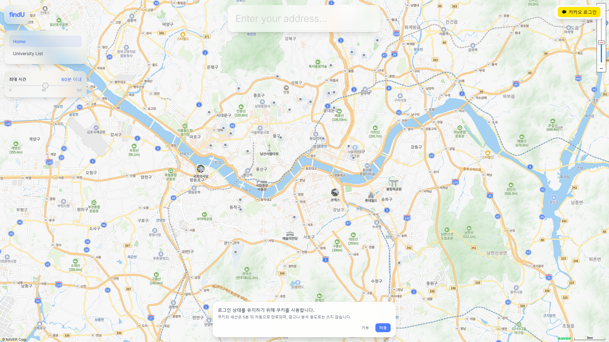
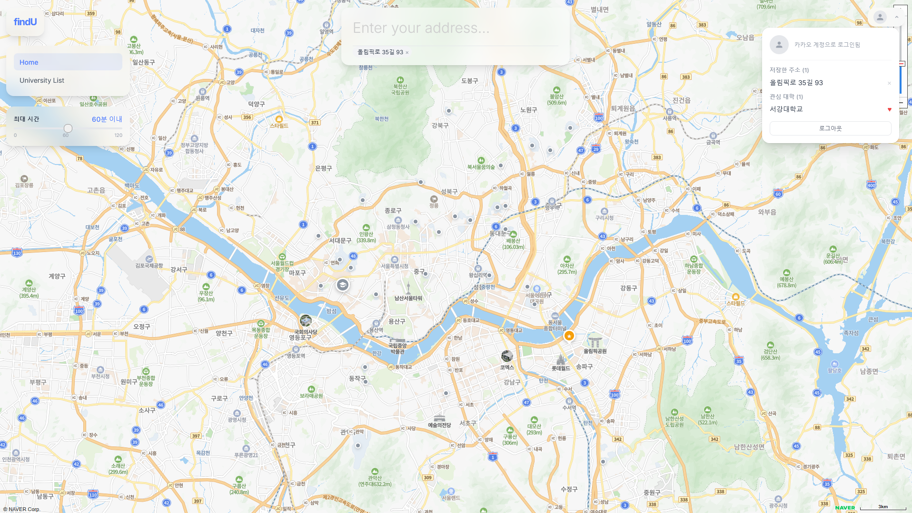
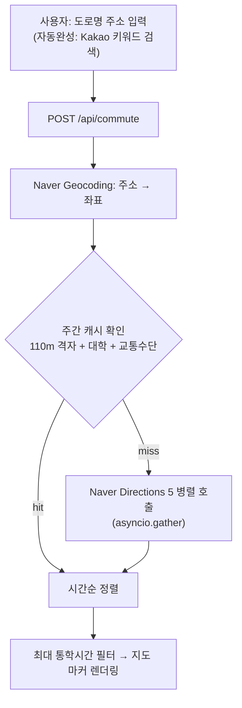

# findU · 집 주소로 찾는 통학 가능 대학

> 집 주소 하나로 수도권 38개 대학까지의 통학 시간을 계산해 가까운 순으로 보여주는 웹 앱.

[](https://github.com/jaewonzzang/findU/actions/workflows/ci.yml)

대학을 고를 때 "집에서 다닐 만한가"는 중요한 기준이지만, 확인하려면 대학마다 지도 앱을 열어 길찾기를 반복해야 한다. findU는 주소 한 번으로 이 비교를 한 화면에 끝낸다.


**▶ Live Demo — https://find-u-iota.vercel.app/** (로그인 없이 바로 검색 가능)

|  |  |
|---|---|
| 🏫 수도권 대학 **38개** 지원 | ⚡ `asyncio` 기반 병렬 경로 계산 |
| 🔐 Kakao OAuth 로그인 | 🚀 Vercel + Railway 배포 |
| 🧪 GitHub Actions CI + pytest | 👤 1인 기획 · 개발 · 배포 |

**Tech.** FastAPI · React 18 · TypeScript · Supabase · Naver/Kakao API

---

## 프로젝트 소개

**문제.** 수험생이 대학을 고를 때 통학 가능성은 큰 기준이다. 그런데 지도 앱은 한 번에 한 경로만 알려줘서, 후보 대학마다 길찾기를 따로 돌려 머릿속으로 비교해야 한다.

**해결.** 집 주소를 한 번 입력하면, 수도권 대학 38곳(분캠 포함)까지의 통학 시간을 병렬로 계산해 가까운 순으로 정렬한다. 입력한 주소를 Naver Geocoding으로 좌표로 바꾸고, 각 대학까지의 소요 시간을 Naver Directions 5로 동시에 구한 뒤, 최대 통학 시간으로 걸러 지도에 마커로 뿌린다.

**결과.** "어느 대학이 통학권인가"를 검색 한 번으로 판단할 수 있고, 로그인하면 집 주소와 관심 대학을 저장해 다음에 클릭 한 번으로 다시 본다. Vercel·Railway에 배포돼 실제로 돌아간다.

---

## 주요 기능

### 통학 시간 검색
- **무엇** — 도로명 주소를 넣으면 대학 38곳까지의 소요 시간을 가까운 순으로 정렬하고, 슬라이더로 최대 통학 시간을 걸러 본다.
- **왜** — 여러 대학을 한 기준(통학 시간)으로 한눈에 비교하는 게 이 앱의 핵심 가치다.
- **어떻게** — `asyncio.gather`로 Directions 호출을 병렬 처리하고, 결과는 통학 시간 색상 마커 + "○○분" 라벨로 지도에 렌더링한다.

### 주소 자동완성
- **무엇** — 입력하는 동안 장소·주소 후보를 띄우고, 고르면 해당 도로명 주소로 검색한다.
- **왜** — Naver Geocoding은 "강남역" 같은 장소명(POI)을 못 잡는다. 사용자가 정확한 도로명 주소를 고르게 해 검색 실패를 줄인다.
- **어떻게** — Kakao 로컬 키워드 검색을 백엔드로 프록시하고, 프론트는 250ms 디바운스로 호출한다. 선택 시 POI 이름이 아닌 도로명 주소를 검색어로 넘긴다.

### 로그인 · 즐겨찾기 (Kakao OAuth)
- **무엇** — 카카오 로그인 후 집 주소를 저장하고 관심 대학을 찜한다. 지도에서는 별 핀(저장 주소)과 학사모 마커(관심 대학)로 구분된다.
- **왜** — 매번 주소를 다시 입력하는 번거로움을 없애고, 관심 대학을 모아 본다.
- **어떻게** — 세션 쿠키 기반 로그인에 `state` 파라미터로 CSRF를 막는다. 저장 데이터는 Supabase에 둔다.

### 폴백 · 레이트 리밋
- **무엇** — 외부 API가 실패하면 추정치로 계산해 `is_fallback`을 붙이고, 주소가 안 잡히면 404를 준다. 엔드포인트별로 요청 수를 제한한다.
- **왜** — 검색 한 번이 Directions 호출 최대 38건을 유발한다. 장애 시에도 화면이 비지 않게 하고, 외부 API 쿼터를 보호한다.
- **어떻게** — `/api/commute` IP당 분당 10회, `/api/autocomplete` 60회로 버킷을 분리한다. 쿠키는 동의를 받고 쓰며 세션·동의 기록 모두 5분 뒤 만료된다.

---

## Stacks 🧭

### Backend


### Frontend


### Database / Auth


### Deploy


---

## 화면 구성 📺

| 첫 화면 · 쿠키 동의 | 주소 검색 → 통학 시간 | 로그인 · 저장 주소/관심 대학 |
| :---: | :---: | :---: |
|  |  |  |

---

## 아키텍처



대중교통 모드는 차량 소요 시간 × 1.3 + 15분으로 추산한다.

### 디렉토리 구조

```bash
├── README.md
├── CLAUDE.md : 작업 가드레일 (아키텍처·엔드포인트·제약)
├── .github/workflows/ci.yml : 백엔드 테스트 + 프론트 빌드
│
├── backend/ : FastAPI + httpx (외부 API 비동기 호출)
│   ├── main.py : 앱 · CORS/세션 미들웨어 · 핵심 엔드포인트
│   ├── models.py : Pydantic 입출력 (CommuteRequest/Response, University)
│   ├── commute_service.py : 지오코딩 + 경로 계산 오케스트레이션
│   ├── commute_cache.py : 주간 인메모리 캐시 (110m 격자 공유)
│   ├── naver_client.py : Naver Geocoding + Directions 5
│   ├── kakao_client.py : Kakao 로컬 키워드 검색 (주소 자동완성)
│   ├── auth.py : Kakao OAuth (세션 쿠키)
│   ├── favorites.py : 저장 주소·관심 대학 (Supabase PostgREST)
│   ├── rate_limit.py : IP당 엔드포인트별 레이트 리밋
│   ├── universities.py / .json : 정적 수도권 38개 대학
│   └── tests/ : pytest (외부 호출 모킹)
│
├── frontend/ : Vite + React 18 + TypeScript + Tailwind
│   └── src/
│       ├── App.tsx : React Router (/ , /universities , /about)
│       ├── api.ts : 백엔드 fetch 래퍼
│       ├── hooks/ : useSearch · useAuth · useFavorites
│       ├── components/ : MinimalSearchBar, MapContainer, AuthButton,
│       │                 SavedAddresses, CookieConsent ...
│       ├── pages/ : UniversityList · About
│       ├── data/ : 대학 목록 정적 데이터
│       └── types/ : 공유 TypeScript 인터페이스
│
└── docs/ : API 명세 · Kakao OAuth 설정 · 데모
```

---

## 핵심 구현 결정

### 왜 통학 시간을 주간 메모리 캐시에 두는가
검색 한 번에 대학 38곳으로 가는 Directions 호출 38건이 나간다. 쿼터를 아끼려고 (출발 좌표, 대학, 교통수단)을 키로 캐싱하고, 좌표는 소수점 3자리(약 110m)로 반올림해 근처 주소끼리 캐시를 공유한다. 통학 시간은 매주 바뀌므로 캐시는 월요일 자정(KST)에 비운다. **Redis가 아니라 프로세스 메모리**를 쓴 이유는, 주 단위로 버리는 값이라 영속화 이득이 적고 지금은 단일 인스턴스이기 때문이다. 인스턴스를 늘리면 Redis로 옮긴다. (`backend/commute_cache.py`)

### 왜 대중교통을 차량 시간으로 추산하는가
NCP에 공개 대중교통 길찾기 API가 없다. 대중교통 모드를 빼는 대신 차량 소요 시간 × 1.3 + 15분으로 추산하고, 결과에 "차량 기준 추산"이라고 표시했다. 정확도를 일부 내주더라도 사용자에게 추정치임을 투명하게 알리는 쪽을 택했다. (`backend/naver_client.py`)

### 왜 즐겨찾기만 Supabase에 저장하는가
저장 주소와 관심 대학은 통근 캐시와 달리 재시작 뒤에도 남아야 한다. 사용자 데이터가 처음 생긴 이 시점에 DB를 붙였다. 클라이언트 라이브러리 없이 이미 쓰던 httpx로 Supabase PostgREST를 직접 호출하고, 테이블은 RLS를 켠 뒤 정책을 만들지 않아 service role 키를 가진 백엔드만 접근하게 잠갔다. (`backend/favorites.py`)

---

## Known Limitations

| 한계 | 지금 상태 | 다음 단계 |
|---|---|---|
| 대중교통 시간이 추산값 | NCP에 대중교통 길찾기 API가 없어 `차량 × 1.3 + 15분`으로 계산, "차량 기준 추산" 표시 | ODsay 등 대중교통 API 연동 |
| 캐시·레이트 리밋이 단일 프로세스 | 프로세스 메모리에 둠. 인스턴스가 여러 개면 캐시가 안 공유되고 한도가 배수로 늘어남 | Redis로 공유 |
| 대학 목록이 정적 JSON | 수도권 38곳 좌표를 고정값으로 관리 | 전국 확대 시 대학알리미 공공데이터로 교체 |
| 세션 5분 | 집 주소를 오래 들고 있지 않으려고 짧게 잡음 | 필요 시 `SESSION_MAX_AGE` 상향 |

---

## What I Learned

- **외부 API 장애를 고려한 폴백 설계** — 실측 실패와 사용자 입력 오류를 구분해, 하나는 추정치 폴백(`is_fallback`), 하나는 404로 처리했다.
- **`asyncio`를 활용한 병렬 처리** — 검색 한 번이 유발하는 38건의 외부 호출을 `asyncio.gather`로 동시에 처리해 응답 시간을 줄였다.
- **캐시 전략 설계** — 좌표를 격자로 뭉쳐 캐시 히트율을 높이고, 데이터 수명(주 단위)에 맞춰 영속화 없이 메모리로 유지하는 판단을 내렸다.
- **OAuth 세션 인증 구현** — `state`로 CSRF를 막고, 배포 환경에서 쿠키가 first-party로 실리도록 프록시 구조를 잡았다.
- **GitHub Actions 기반 CI 구축** — push마다 백엔드 pytest와 프론트 빌드를 자동 검증하게 했다.

---

## 시작 가이드

### Requirements
- [Python 3.11+](https://www.python.org/downloads/)
- [Node.js 18+](https://nodejs.org/) / npm

### Backend
```bash
$ cd backend
$ pip install -r requirements.txt
$ uvicorn main:app --reload
# → http://localhost:8000/api/health · http://localhost:8000/docs (Swagger)
```
환경 변수는 `backend/.env.example` 참고. Naver 키가 없으면 추정치로 폴백해서 그대로 실행된다. Kakao OAuth 설정은 [`docs/kakao-oauth-setup.md`](./docs/kakao-oauth-setup.md).

테스트:
```bash
$ cd backend
$ pip install -r requirements-dev.txt
$ pytest tests
```

### Frontend
```bash
$ cd frontend
$ npm install
$ npm run dev     # http://localhost:5173
```
환경 변수 `VITE_NAVER_MAP_CLIENT_ID`(Naver Maps JS SDK). `/api`는 dev 프록시로 백엔드에 붙어 배포와 같은 first-party 쿠키 구조로 돈다.
