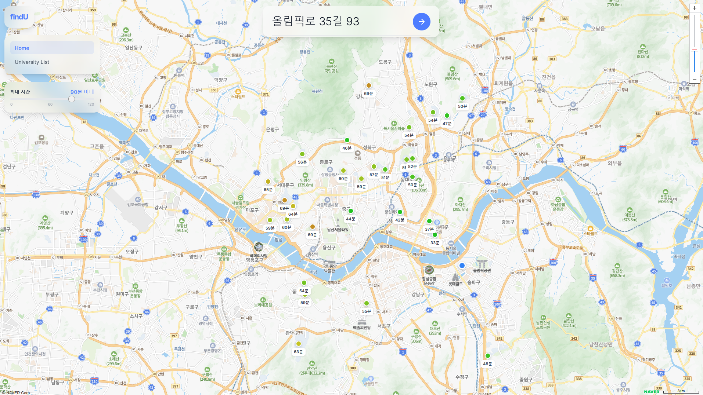
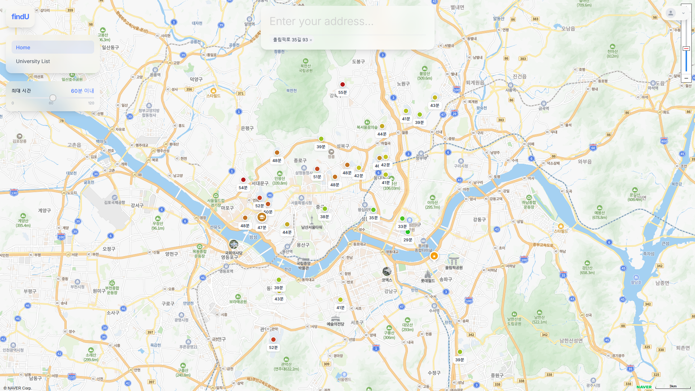

# findU · 집 주소로 찾는 통학 가능 대학

> 집 주소 하나로 수도권 38개 대학까지의 통학 시간을 계산해 가까운 순으로 보여준다.
> 개발기간 2025.11 ~ 2026.07

[](https://github.com/jaewonzzang/findU/actions/workflows/ci.yml)

## 배포 주소

> **Live:** https://find-u-iota.vercel.app/ <br>
> 프론트엔드 Vercel, 백엔드 Railway. <br>
> 로그인 없이 주소 검색은 그대로 되고, 저장·즐겨찾기만 로그인이 필요하다.

## 만든 사람

|      김재원       |
| :------------------------------: |
| 기획 · 백엔드 · 프론트 · 배포 단독 개발 |

이 리포의 전 커밋을 작성했다.

## 프로젝트 소개

대학을 고를 때 "집에서 다닐 만한가"는 중요한 기준인데, 확인하려면 대학마다 지도 앱을 열어 길찾기를 반복해야 한다. findU는 집 주소를 한 번 넣으면 수도권 대학 38곳(분캠 포함)까지의 통학 시간을 한 화면에 정렬해 준다.

입력한 주소를 Naver Geocoding으로 좌표로 바꾸고, 각 대학까지의 소요 시간을 Naver Directions 5로 병렬 계산한 다음, 최대 통학 시간으로 걸러 가까운 순으로 정렬한다.

## 시작 가이드

### Requirements

- [Python 3.11+](https://www.python.org/downloads/)
- [Node.js 18+](https://nodejs.org/) / npm

### Installation

```bash
$ git clone https://github.com/jaewonzzang/findU.git
$ cd findU
```

#### Backend

```bash
$ cd backend
$ pip install -r requirements.txt
$ uvicorn main:app --reload
# → http://localhost:8000/api/health · http://localhost:8000/docs (Swagger)
```

환경 변수는 `backend/.env.example` 참고. Naver 키가 없으면 추정치로 폴백해서 그대로 실행된다. Kakao OAuth 설정은 [`docs/kakao-oauth-setup.md`](./docs/kakao-oauth-setup.md).

테스트:

```bash
$ cd backend
$ pip install -r requirements-dev.txt
$ pytest tests
```

캐시, 대중교통 추산식, `/api/commute`의 성공·폴백·404, 레이트 리밋을 커버한다. 백엔드 테스트와 프론트 빌드는 push마다 GitHub Actions로 돈다.

#### Frontend

```bash
$ cd frontend
$ npm install
$ npm run dev     # http://localhost:5173
```

환경 변수 `VITE_NAVER_MAP_CLIENT_ID`(Naver Maps JS SDK). `/api`는 dev 프록시로 백엔드에 붙어 배포와 같은 first-party 쿠키 구조로 돈다.

---

## Stacks 🧭

### Environment


### Backend


### Data / Auth


### Frontend


### Deploy


---

## 화면 구성 📺



| 첫 화면 · 쿠키 동의 | 주소 검색 → 통학 시간 | 로그인 · 저장 주소/관심 대학 |
| :---: | :---: | :---: |
|  |  |  |

---

## 주요 기능 📦

### 통학 시간 검색
도로명 주소를 넣으면 대학 38곳까지의 소요 시간을 `asyncio.gather`로 병렬 계산해 가까운 순으로 정렬한다. 왼쪽 슬라이더로 최대 통학 시간을 조절하면 지도 마커가 바로 걸러지고, 각 대학은 통학 시간 색상 마커와 "○○분" 라벨로 표시된다.

### 주소 자동완성
입력하는 동안 Kakao 키워드 검색으로 장소·주소 후보를 띄운다(디바운스 250ms). "강남역" 같은 장소명을 골라도 그 도로명 주소로 검색하기 때문에 Naver 지오코딩이 실패하지 않는다.

### 로그인 · 즐겨찾기 (Kakao OAuth)
세션 쿠키 기반 로그인이고 `state` 파라미터로 CSRF를 막는다. 검색한 집 주소를 저장해 클릭 한 번으로 다시 찾을 수 있고, 대학 목록에서 관심 대학을 찜한다. 저장 주소와 관심 대학은 프로필 패널에 모이고 지도에서는 별 핀과 학사모 마커로 구분된다.

### 폴백과 레이트 리밋
외부 API가 실패하면 추정치로 계산하고 결과에 `is_fallback`을 붙인다. 반대로 주소가 하나도 안 잡히면(입력 오류) 폴백 없이 404를 준다. `/api/commute`는 IP당 분당 10회, `/api/autocomplete`는 60회로 제한한다. 쿠키는 동의를 받고 쓰며 세션과 동의 기록 모두 5분 뒤 만료된다. 광고·분석 쿠키는 없다.

---

## 아키텍처

```
도로명 주소 입력 (자동완성: Kakao 키워드 검색)
   │
   ▼
POST /api/commute
   │
   ├─ Naver Geocoding: 주소 → 좌표
   ├─ 주간 캐시 조회 (좌표 110m 격자 + 대학 + 교통수단 키)
   ├─ 캐시 미스분만 Naver Directions 5 병렬 호출 (asyncio.gather)
   │    └─ 대중교통 모드: 차량 시간 × 1.3 + 15분
   ▼
최대 통학시간 필터 → 시간순 정렬 → 지도 마커로 렌더링
```

### 디렉토리 구조

```bash
├── README.md
├── CLAUDE.md : 작업 가드레일 (아키텍처·엔드포인트·제약)
├── .github/workflows/ci.yml : 백엔드 테스트 + 프론트 빌드
│
├── backend/ : FastAPI + httpx (외부 API 비동기 호출)
│   ├── main.py : 앱 · CORS/세션 미들웨어 · 핵심 엔드포인트
│   ├── models.py : Pydantic 입출력 (CommuteRequest/Response, University)
│   ├── commute_service.py : 지오코딩 + 경로 계산 오케스트레이션
│   ├── commute_cache.py : 주간 인메모리 캐시 (110m 격자 공유)
│   ├── naver_client.py : Naver Geocoding + Directions 5
│   ├── kakao_client.py : Kakao 로컬 키워드 검색 (주소 자동완성)
│   ├── auth.py : Kakao OAuth (세션 쿠키)
│   ├── favorites.py : 저장 주소·관심 대학 (Supabase PostgREST)
│   ├── rate_limit.py : IP당 엔드포인트별 레이트 리밋
│   ├── universities.py / .json : 정적 수도권 38개 대학
│   └── tests/ : pytest (외부 호출 모킹)
│
├── frontend/ : Vite + React 18 + TypeScript + Tailwind
│   └── src/
│       ├── App.tsx : React Router (/ , /universities , /about)
│       ├── api.ts : 백엔드 fetch 래퍼
│       ├── hooks/ : useSearch · useAuth · useFavorites
│       ├── components/ : MinimalSearchBar, MapContainer, AuthButton,
│       │                 SavedAddresses, CookieConsent ...
│       ├── pages/ : UniversityList · About
│       ├── data/ : 대학 목록 정적 데이터
│       └── types/ : 공유 TypeScript 인터페이스
│
└── docs/ : API 명세 · Kakao OAuth 설정 · 데모
```

## 핵심 구현 결정

**통학 시간은 주간 인메모리 캐시** (`backend/commute_cache.py`)

검색 한 번에 대학 38곳으로 가는 Directions 호출 38건이 나간다. 쿼터를 아끼려고 (출발 좌표, 대학, 교통수단)을 키로 캐싱하고, 좌표는 소수점 3자리(약 110m)로 반올림해 근처 주소끼리 캐시를 공유한다. 통학 시간은 매주 바뀌므로 캐시는 월요일 자정(KST)에 비운다. 주 단위로 버리는 값이라 DB는 두지 않았다.

**대중교통은 차량 기준 추산** (`backend/naver_client.py`)

NCP에 공개 대중교통 길찾기 API가 없다. 차량 소요 시간 × 1.3 + 15분으로 추산하고, 결과에 "차량 기준 추산"이라고 표시한다.

**즐겨찾기는 Supabase Postgres** (`backend/favorites.py`)

저장 주소와 관심 대학은 재시작 뒤에도 남아야 해서 DB를 붙였다. 클라이언트 라이브러리 없이 httpx로 Supabase PostgREST를 직접 호출한다. 테이블은 RLS를 켜고 정책을 만들지 않아, service role 키를 가진 백엔드만 접근한다.

## 알려진 한계와 다음 단계

| 한계 | 지금 상태 | 다음 단계 |
|---|---|---|
| 대중교통 시간이 추산값 | NCP에 대중교통 길찾기 API가 없어 `차량 × 1.3 + 15분`으로 계산, "차량 기준 추산" 표시 | ODsay 등 대중교통 API 연동 |
| 캐시·레이트 리밋이 단일 프로세스 | 프로세스 메모리에 둠. 인스턴스가 여러 개면 캐시가 안 공유되고 한도가 배수로 늘어남 | Redis로 공유 |
| 대학 목록이 정적 JSON | 수도권 38곳 좌표를 고정값으로 관리 | 전국 확대 시 대학알리미 공공데이터로 교체 |
| 세션 5분 | 집 주소를 오래 들고 있지 않으려고 짧게 잡음 | 필요 시 `SESSION_MAX_AGE` 상향 |
